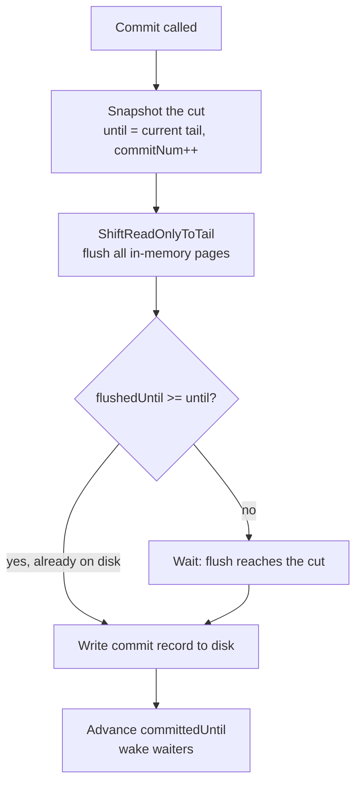

# RFC: A Single-Threaded, Fiber-Based Durable Log

**Status:** Draft
**Target:** C++17/20, single OS thread, cooperative fibers, fiber-blocking I/O
**Interface model:** Microsoft FasterLog (`Enqueue` / `Commit` / `WaitForCommit` / `Scan` / `TruncateUntil`)
**Storage model:** HybridLog allocator + segmented log device + separate commit files

---

## Abstract

This document specifies the design of a persistent, recoverable, append-only log
for a single-threaded runtime that uses cooperative fibers for concurrency and
fiber-blocking I/O. It follows the public interface of Microsoft's FasterLog and
the durability model (prefix recovery) introduced by the FASTER / CPR line of
work, but deliberately strips out the multi-threaded machinery (epoch protection,
the safe-read-only/fuzzy region, latch-free CAS paths) that single-threaded
execution makes unnecessary.

The core claim, inherited from FASTER, is that **flushing data to disk and
committing it are two distinct events**, separated by a small metadata write. The
design makes that separation explicit and builds recovery on top of it.

---

## 1. Scope and non-goals

**In scope:** append (`Enqueue`), durable commit, blocking on commit, scan /
tailing iteration, head truncation, crash recovery to a consistent prefix.

**Non-goals:** the hash index and key-value operations (Read/Upsert/RMW); these
sit *above* this log and are out of scope here. Multi-thread concurrency is also
out of scope — the design assumes a single writer fiber and cooperative
scheduling. In-place record mutation (the KV store's mutable region) is not
required for a pure log; the mutable/read-only split is retained only as a
flush-timing mechanism.

---

## 2. Terminology

| Term                | Meaning                                                                                                                   |
|---------------------|---------------------------------------------------------------------------------------------------------------------------|
| **Logical address** | A 64-bit position in the conceptually infinite log, starting at 0. Not a memory pointer.                                  |
| **Page**            | Fixed-size unit of the log (`2^page_bits` bytes). Allocation and flushing happen at page granularity.                     |
| **Segment**         | A file on disk holding a fixed number of pages (`2^segment_bits` bytes).                                                  |
| **Tail**            | The next free logical address; where `Enqueue` allocates.                                                                 |
| **Flush**           | Writing a sealed page to the log device. Advances `flushedUntil`. Eviction / memory management, **not** durability.       |
| **Commit**          | Durably recording a recoverable point (a prefix boundary). Advances `committedUntil`.                                     |
| **Fold-over**       | Forcing the read-only boundary up to the tail so the entire in-memory region flushes; the log becomes its own checkpoint. |

---

## 3. Background: the HybridLog address space

The log is a single 64-bit logical address space. A bounded in-memory circular
buffer holds the tail of that space; everything older lives on the device. Three
internal markers split the resident region:

```
addr 0          headOffset        readOnlyOffset                tailOffset
  |                 |                   |                            |
  v                 v                   v                            v
  +-----------------+-------------------+----------------------------+
  |     STABLE      |     READ-ONLY     |          MUTABLE           |
  |   (on disk)     |   sealed, flush   |   open, append at tail     |
  +-----------------+-------------------+----------------------------+
   \___ on disk ___/ \________ resident in circular buffer _________/
```

A record's logical address never changes. As the tail grows, the markers slide
right and a record drifts `MUTABLE -> READ-ONLY -> STABLE`. That drift is the
eviction policy; no per-record statistics are kept.

**Address -> memory mapping** (valid only when `addr >= head`):

```
frame_index = (addr >> page_bits) % num_frames
byte_offset = addr &  (page_size - 1)
physical    = frames[frame_index].buf + byte_offset
```

> **Single-threaded simplification.** Because there is exactly one writer and no
> preemption, the *safe-read-only offset* and *fuzzy region* from the FASTER
> paper are unnecessary: `readOnlyOffset` is always current at the moment it is
> read. Epoch protection, the tentative bit, and CAS loops are likewise dropped.

---

## 4. Architecture

FasterLog is a thin API over two subsystems, each persisting to its own file set.

```mermaid
graph TD
    EnqueueCall[Enqueue]:::call --> Allocator
    CommitCall[Commit]:::call --> CommitMgr

    subgraph FasterLog
        Allocator[Allocator<br/>circular buffer of pages]
        CommitMgr[Commit manager<br/>persists recovery info]
    end

    Allocator -->|flush pages| LogDevice[Log device<br/>segment files = data]
    CommitMgr -->|write record| CommitFiles[Commit files<br/>newest = recovery point]

    classDef call fill:transparent,stroke-dasharray:3 3;
```

The two-file separation is fundamental: the **log device** carries record data,
the **commit files** carry recovery metadata. A record reaching the log device is
"flushed"; the commit record naming that record is what makes it "committed."

---

## 5. Configuration

```cpp
struct LogSettings {
    int    page_bits    = 22;    // 4 MB pages   (FasterLog default is 25 = 32 MB)
    int    memory_bits  = 26;    // 64 MB resident -> 2^(26-22) = 16 pages in RAM
    int    segment_bits = 30;    // 1 GB segment files on disk
    double mutable_frac = 0.9;   // last 90% of RAM stays unflushed until commit
    bool   checksum     = false; // per-entry checksum (12-byte header vs 4); see §11
    std::string dir;             // log device + commit files live here
};
```

Derived quantities:

| Quantity           | Formula                                      |
|--------------------|----------------------------------------------|
| `page_size`        | `1 << page_bits`                             |
| `pages_in_memory`  | `1 << (memory_bits - page_bits)` (minimum 2) |
| `segment_size`     | `1 << segment_bits`                          |
| pages per segment  | `segment_size / page_size`                   |
| `segment_id(addr)` | `addr >> segment_bits`                       |

---

## 6. Address markers and the durability model

Four addresses are exposed, and they are always sorted:

```
beginAddress      committedUntil      flushedUntil                tailAddress
   |                   |                   |                           |
   v                   v                   v                           v
   +-------------------+-------------------+---------------------------+
   |     committed     |   flushed only    |      in memory only       |
   |  survives crash   |   lost on crash   |         volatile          |
   +-------------------+-------------------+---------------------------+
    \______________ persisted on disk _______________/
```

`beginAddress <= committedUntil <= flushedUntil <= tailAddress`

- `Enqueue` advances **tailAddress** (in memory, not durable).
- Background page flushing advances **flushedUntil** (on disk, not yet recoverable).
- `Commit` advances **committedUntil** (recoverable). This is the only durability line.
- `TruncateUntil` raises **beginAddress** (the floor).

The middle band — flushed but not committed — is the subtle one: that data is
physically on the SSD yet is discarded on recovery, because no commit record
names it.

**Guarantee (single-threaded prefix recovery).** After a crash, the log recovers
to exactly `[beginAddress, committedUntil)` of the most recent commit. For two
enqueues `e1` then `e2`, recovery contains none, only `e1`, or both — never `e2`
without `e1`. This is the single-session specialization of FASTER's Concurrent
Prefix Recovery (CPR).

---

## 7. Data structures

### 7.1 Logical address

```cpp
using Address = int64_t;                  // 64-bit logical address, starts at 0
constexpr Address kInvalid = -1;
```

### 7.2 Device (segmented files)

The device abstracts the on-disk segment files. The reference implementation is
`io_uring`-backed and shares a single registered buffer with the allocator's
circular buffer (see §12).

```cpp
class IDevice {                            // fiber-blocking I/O: yields, never spins
public:
    virtual void WritePage(const uint8_t* src, Address dest, size_t n) = 0;  // eager flush, no fsync
    virtual void Read     (uint8_t* dst,       Address src,  size_t n) = 0;
    virtual void RemoveSegment(int segment_id) = 0;          // truncation

    // Durability barrier: make written data durable, write the commit record,
    // make the record durable — in strict order. Used by Commit (§9.2), not the
    // eager flush path. Implemented as a single linked submission in §12.
    virtual void CommitBarrier(const RecoveryInfo& info) = 0;

    virtual ~IDevice() = default;
};
```

### 7.3 Allocator (circular buffer + markers)

```cpp
struct Page {
    uint8_t* buf = nullptr;                // points INTO the shared arena (§12); not owned
    enum class State { Free, Filling, Sealed, Flushed } state = State::Free;
};

class Allocator {
public:
    Address  Allocate(int size);           // bump tail; seal + queue flush on page cross
    uint8_t* Get(Address a);               // physical ptr; valid only if a >= head_
    void     ShiftReadOnlyToTail();        // commit's fold-over: flush everything in RAM
    Address  Tail()         const { return tail_; }
    Address  FlushedUntil() const { return flushed_until_; }

    std::function<void(Address)> on_flushed;  // fires when flushed_until_ advances

private:
    std::vector<Page> pages_;              // size = pages_in_memory
    Address tail_ = 0, read_only_ = 0, head_ = 0, flushed_until_ = 0;
    IDevice* device_;
    void FlushSealedPages();               // writes pages below read_only_, advances flushed_until_
    void WaitUntilSpaceAvailable(int size); // yields fiber until head_ advances enough
};
```

```cpp
Address Allocator::Allocate(int size) {
    if (size > page_size) {
        throw std::invalid_argument("Entry size exceeds maximum page size");
    }

    WaitUntilSpaceAvailable(size);         // Backpressure: yield if (tail_ + size) - head_ > capacity
    
    int off = tail_ & (page_size - 1);
    if (off + size > page_size) {          // won't fit: seal this page, move on
        pages_[page_of(tail_) % pages_.size()].state = Page::State::Sealed;
        tail_ = (page_of(tail_) + 1) << page_bits;
        FlushSealedPages();                // may yield while writing; advances flushed_until_
        
        // Wait again because skipping to the next page might have exhausted capacity
        WaitUntilSpaceAvailable(size);
    }
    Address a = tail_;
    tail_ += size;
    return a;
}
```

> **Note on Maximum Entry Size:** Because the circular buffer is logically sliced into fixed `page_size` blocks and entries are never split across pages, the maximum size of a single entry is bounded by the page size. FASTER handles oversized entries by using a separate object store, but for a pure log, rejecting them with an exception is the safest approach to maintain memory invariants and zero-copy reads.

> **Note on Backpressure:** Because this is a single-threaded cooperative runtime, the writer fiber cannot spin or fail silently if the circular buffer is full (i.e., `tail_ - head_ >= arena.bytes()`). The `WaitUntilSpaceAvailable` method must yield the fiber. Crucially, `head_` (the eviction tail) can only advance after data is durable on disk (when `flushed_until_` advances). The fiber wakes up when the `OnFlushed` continuation (which is triggered when `device_->WritePage` completes) advances `flushed_until_` and frees up `head_`.

### 7.4 Recovery info (the entire durable commit record)

```cpp
struct RecoveryInfo {
    Address begin_address;
    Address until_address;                 // the committed-prefix boundary
    int64_t commit_num;                    // monotonic; recover to this exact point
    std::vector<uint8_t> cookie;           // user metadata, atomically persisted
    std::map<std::string, Address> iterators;  // named iterator positions

    std::vector<uint8_t> Serialize() const;
    static RecoveryInfo Deserialize(std::span<const uint8_t>);
};
```

### 7.5 Commit manager

```cpp
class ICommitManager {
public:
    virtual void Commit(const RecoveryInfo&) = 0;     // atomic write of one commit file
    virtual std::optional<RecoveryInfo> GetLatest() = 0;
    virtual void RemoveCommits(int64_t keep_num) = 0;
    virtual ~ICommitManager() = default;
};
```

### 7.6 FasterLog (top level)

```cpp
class FasterLog {
public:
    explicit FasterLog(const LogSettings&);  // recovers from latest commit if present

    Address Enqueue(std::span<const uint8_t> entry);
    bool    TryEnqueue(std::span<const uint8_t> entry, Address& out);
    void    Commit(bool spin_wait = false);  // issues; returns immediately by default
    void    WaitForCommit(Address until = 0);// does NOT issue a commit
    Address EnqueueAndWaitForCommit(std::span<const uint8_t> entry);
    void    TruncateUntil(Address a);
    ScanIterator Scan(Address begin, Address end, std::string name = "",
                      bool recover = true, bool scan_uncommitted = false);

    Address BeginAddress()          const { return begin_; }
    Address TailAddress()           const { return alloc_.Tail(); }
    Address FlushedUntilAddress()   const { return alloc_.FlushedUntil(); }
    Address CommittedUntilAddress() const { return committed_until_; }

private:
    Allocator       alloc_;
    ICommitManager* commit_mgr_;
    Address begin_ = 0, committed_until_ = 0, safe_tail_ = 0;
    int64_t commit_num_ = 0;
    std::deque<std::pair<Address, RecoveryInfo>> pending_commits_;  // ordered by until
    void OnFlushed(Address new_flushed);     // drains pending_commits_ -> writes commit files
    void Recover();
};
```

---

## 8. Public interface

Mirrors FasterLog so application code ports directly.

```cpp
// Append (to memory only — not durable)
Address Enqueue(std::span<const uint8_t> entry);
bool    TryEnqueue(std::span<const uint8_t> entry, Address& out);   // false if full (throttle)

// Durability (issues a commit; returns immediately unless spin_wait)
void    Commit(bool spin_wait = false);

// Block until durable (does NOT issue a commit)
void    WaitForCommit(Address until = 0);

// Convenience: append then wait (still does not itself issue the commit)
Address EnqueueAndWaitForCommit(std::span<const uint8_t> entry);

// Head truncation
void    TruncateUntil(Address a);

// Iteration (committed-only by default; tailing when end == INT64_MAX)
ScanIterator Scan(Address begin, Address end, std::string name = "",
                  bool recover = true, bool scan_uncommitted = false);
```

Entry wire format on the log (see §11 for integrity details):

```
checksum off   no checksum:  [ length : 4 ][ payload ... ]      headerSize = 4
checksum on:                 [ checksum : 8 ][ length : 4 ][ payload ... ]   headerSize = 12
```

The checksum occupies offset 0; the length field follows at offset +8. This
matches FasterLog (`headerSize = PerEntry ? 12 : 4`).

---

## 9. Call flows

### 9.1 Enqueue

Frame the entry, allocate at the tail, copy, return its address. No durability.

```cpp
Address FasterLog::Enqueue(std::span<const uint8_t> e) {
    int size = header_size_ + (int)e.size();         // 4 or 12 byte header + payload
    Address a = alloc_.Allocate(size);
    uint8_t* p = alloc_.Get(a);
    SetHeader(p, (uint32_t)e.size());                 // writes length, and checksum if enabled
    std::memcpy(p + header_size_, e.data(), e.size());
    // NOTE: when checksums are on, compute over [length field + payload] AFTER
    // the payload is copied, then store it at offset 0 (see §11).
    return a;                                          // in memory only — not yet durable
}
```

### 9.2 Commit



```cpp
void FasterLog::Commit(bool spin_wait) {
    RecoveryInfo info;
    info.begin_address = begin_;
    info.until_address = alloc_.Tail();              // the cut = current tail
    info.commit_num    = ++commit_num_;
    info.cookie        = current_cookie_;
    info.iterators     = SnapshotIterators();

    pending_commits_.push_back({info.until_address, info});
    alloc_.ShiftReadOnlyToTail();                    // force flush of all in-memory pages

    if (alloc_.FlushedUntil() >= info.until_address) // fast path: data already on disk
        OnFlushed(alloc_.FlushedUntil());            // -> writes commit file right now
    if (spin_wait) WaitForCommit(info.until_address);
}
```

The bottom three boxes of the flowchart run either *now* (fast path) or *later*,
inside the flush-completion continuation — which on a fiber runtime is simply the
code that resumes after `device_->WritePage` returns. Deferring them is the
group-commit win: the append path never blocks on disk.

### 9.3 OnFlushed (the drain that promotes flushed -> committed)

```cpp
void FasterLog::OnFlushed(Address f) {
    while (!pending_commits_.empty() && pending_commits_.front().first <= f) {
        auto [until, info] = pending_commits_.front();
        commit_mgr_->Commit(info);          // durable metadata write
        committed_until_ = until;           // THE durability line advances
        pending_commits_.pop_front();
        WakeWaiters(until);                 // resume fibers blocked in WaitForCommit
    }
}
```

FIFO order is mandatory: a later commit must not become durable before an earlier
one, which yields the causality guarantee ("commit an entry only if all
predecessors are committed"). If a flush errors for a range, stop draining at that
range and surface the error; nothing past it commits.

### 9.4 WaitForCommit

Issues nothing. If `until == 0`, snap to the current tail, then yield the fiber
until `committed_until_ >= until`. `EnqueueAndWaitForCommit` is `Enqueue` followed
by `WaitForCommit(addr + size)`; it does **not** call `Commit`, preserving the
ability to batch commits in the background.

### 9.5 Recovery

```cpp
void FasterLog::Recover() {
    auto info = commit_mgr_->GetLatest();
    if (!info) return;                       // fresh log: all markers stay 0
    begin_           = info->begin_address;
    committed_until_ = info->until_address;
    commit_num_      = info->commit_num;
    alloc_.ResetTo(info->until_address);     // tail = flushed = until; discard anything above
    RestoreIterators(info->iterators);
    recovered_cookie_ = info->cookie;
}
```

`ResetTo(until)` rewinds the tail down to the last committed address; the
"flushed only" band at crash time is thrown away. No log replay is needed because
the log *is* the data — there is no separate index to reconcile (that
reconciliation step belongs to the full KV store, not this log).

### 9.6 Truncation

`TruncateUntil(a)` raises `begin_ = a` immediately, but defers physical segment
deletion until the next commit persists the new begin. Otherwise a crash between
"deleted the file" and "recorded the new begin" would point recovery at missing
data. At the next `commit_mgr_->Commit`, after the new begin is durable, call
`device_->RemoveSegment` for whole segments below it.

---

## 10. Durability guarantees

- **Opt-in.** Durability work happens only on `Commit`; the append/flush fast path
  is free of it.
- **Prefix-consistent.** Recovery restores exactly `[begin, committedUntil)` of
  the latest commit. Monotonic, gap-free.
- **Two-phase.** Data is flushed to the log device *before* the commit record is
  written. `committedUntil <= flushedUntil` is invariant.
- **Causal.** Commits become durable in FIFO order; an entry commits only after
  all predecessors do.
- **Strong-commit option.** A commit may carry a caller-chosen `commit_num`
  (recover to exactly that point) and a `cookie` (arbitrary metadata persisted
  atomically with the commit).

---

## 11. Integrity (checksums)

Checksums are **optional** and **per entry**. They live in the record header, not
in a side structure.

### 11.1 Placement

```
checksum on:   [ checksum : 8 ][ length : 4 ][ payload ... ]   header = 12 bytes
checksum off:  [ length : 4 ][ payload ... ]                   header =  4 bytes
```

The checksum is at offset 0; the length field at offset +8. It covers the
**length field plus the payload** — i.e. `header[8 ..]` for `4 + length` bytes.

### 11.2 When it is computed and verified

- **Computed at enqueue**, after the payload is copied into the page, and written
  into the header. In memory; no I/O involved.
- **Verified on read** (`ReadAsync` / random read): recompute over the entry and
  compare; mismatch is a hard error.
- **Verified during the recovery / iteration scan**, where it doubles as an
  end-of-valid-data delimiter (a failing checksum marks where the trustworthy log
  ends).

```cpp
void SetHeader(uint8_t* p, uint32_t length) {
    if (!checksum_) { *(uint32_t*)p = length; return; }
    *(uint32_t*)(p + 8) = length;
    *(uint64_t*)p = Checksum(p + 8, length + 4);   // cover length field + payload
}
bool VerifyChecksum(const uint8_t* p, uint32_t length) {
    if (!checksum_) return true;
    return *(const uint64_t*)p == Checksum(p + 8, length + 4);
}
```

### 11.3 Algorithm choice

For production safety, use **CRC32C**, which is hardware-accelerated (`_mm_crc32_u64` on x86, or the CRC instructions on ARM). It takes nanoseconds per 4KB record (virtually identical to the cost of an XOR fold) but provides robust protection against burst errors and aliasing that simple XOR misses. The checksum occupies the same 8-byte header slot; only the `Checksum()` body changes.

### 11.4 Interaction with commit mode

The checksum's importance depends on how commits are recorded:

- **Default — separate commit file.** Recovery reads `committedUntil` from the
  newest commit file and trusts `[begin, committedUntil)`. The per-entry checksum
  is defense-in-depth on reads; it does not gate recovery.
- **Fast commit — inline commit records.** Commit points are appended into the log
  itself as special records (marked by a **negative length** field to distinguish
  them from data). There is no metadata file; recovery **scans** the log to find
  them. The checksum is now load-bearing: the scan verifies each record to trust
  the inline commit markers and to locate the true end of the log. This is why
  fast commit requires checksums to be enabled.

---

## 12. io_uring integration (registered buffers and files)

The reference device uses `io_uring` with **registered fixed buffers** and
**registered files**. The design integrates cleanly because the allocator's
existing flush/evict ordering already supplies the invariant fixed buffers
require: an in-flight buffer must stay valid and unmodified from submission to
completion, which is exactly the `Sealed` (immutable) + not-yet-evicted state of a
page being flushed.

### 12.1 The shared arena (tinyio FixedBufferPool integration)

The resident window is allocated as **one contiguous, block-aligned slab**. Page
frames slice it. Instead of managing a separate `posix_memalign` and buffer registration, `PageArena` requests its memory directly from `tinyio::FixedBufferPool` (which registers the buffers for the entire `io_uring` runtime).

Configure `tinyio` with one massive bucket specifically for the log (e.g., 64MB). `PageArena` acquires this single slot:

```cpp
class PageArena {
public:
    PageArena(tinyio::FixedBufferPool& pool, size_t num_frames, size_t page_size)
        : page_size_(page_size), bytes_(num_frames * page_size) {
        auto res = pool.Take(bytes_);
        if (!res) throw std::bad_alloc();
        fixed_buf_ = std::move(*res);
    }
    
    uint8_t* base() const { return static_cast<uint8_t*>(fixed_buf_.Ptr()); }
    uint32_t buf_index() const { return fixed_buf_.Index(); }
    size_t   bytes() const { return bytes_; }
    uint8_t* frame(int i) const { return base() + size_t(i) * page_size_; }
private:
    tinyio::FixedBuffer fixed_buf_;
    size_t page_size_, bytes_;
};
```

### 12.1.1 The RAII Lifetime Pitfall
`tinyio::FixedBuffer` is an RAII object. When `PageArena` is destroyed, the 64MB slot is automatically returned to the `FixedBufferPool` free list. 
**Critical:** You must ensure no background `WRITE_FIXED` SQEs are still in flight when the log is destroyed. If the log is shut down while a page is still flushing, the `FixedBuffer` is returned to the pool and might be immediately acquired by a network socket. The kernel will then blindly overwrite that socket's data as the background flush completes. 
**Solution:** The shutdown sequence must explicitly yield the fiber until `flushed_until_` catches up to the tail, ensuring the kernel is completely done with the buffer before allowing `PageArena` to destruct.

### 12.2 Registration
Registration of the memory is handled globally by `tinyio::IO::RegisterBuffers(pool)`. The log only needs to register the sparse file descriptors:

```cpp
io_uring_register_files_sparse(&ring_, MAX_SEGMENTS); // sparse fd table for segments
```

### 12.3 Eager flush: WRITE_FIXED

The flush source is always inside the arena, so every page flush is a fixed write
against a registered segment fd. No `fsync` here — eager flushes are eviction, not
durability.

```cpp
void UringDevice::WritePage(const uint8_t* src, Address dest, size_t n) {
    int   slot = SegmentSlot(dest >> segment_bits_);
    off_t off  = dest & ((1LL << segment_bits_) - 1);
    
    // O_DIRECT requires block-aligned sizes. Pad partial page flushes.
    // This is safe because the PageArena backing memory extends to the end of the page.
    constexpr size_t kSectorSize = 4096;
    size_t aligned_n = (n + kSectorSize - 1) & ~(kSectorSize - 1);

    io_uring_sqe* sqe = io_uring_get_sqe(&ring_);
    io_uring_prep_write_fixed(sqe, slot, src, aligned_n, off, arena_->buf_index());
    sqe->flags |= IOSQE_FIXED_FILE;
    io_uring_sqe_set_data(sqe, sched_.current());
    io_uring_submit(&ring_);
    if (int r = sched_.wait_io(); r < 0) throw DeviceError(-r);
}
```

> **Note on `O_DIRECT` alignment:** When `ShiftReadOnlyToTail()` forces a flush on an incomplete page, `n` will not be block-aligned. `O_DIRECT` strictly requires the memory address, file offset, and length to be sector-aligned. We round `n` up to the next 4096-byte boundary. Memory bounds are not violated because `src` points into the `PageArena`, which is guaranteed to have allocated space up to the end of the current `page_size`. Recovery relies on `committedUntil` and per-entry checksums/lengths to ignore the trailing garbage.

### 12.4 Completion reaper (fiber bridge)

Called by the scheduler when all fibers are parked on I/O. `user_data` is the
`Fiber*`; intermediate linked SQEs carry `nullptr` and are skipped.

```cpp
void UringDevice::pump(bool block) {
    if (block) io_uring_submit_and_wait(&ring_, 1);
    unsigned head, count = 0; io_uring_cqe* cqe;
    io_uring_for_each_cqe(&ring_, head, cqe) {
        if (Fiber* f = (Fiber*)io_uring_cqe_get_data(cqe)) { f->io_res = cqe->res; sched_.make_runnable(f); }
        ++count;
    }
    io_uring_cq_advance(&ring_, count);
}
```

### 12.5 Commit barrier: kernel-enforced ordering

`CommitBarrier` runs after the data writes for the cut have completed
(`flushedUntil >= until`, their CQEs already reaped). It issues a single linked
chain so the commit record cannot reach disk before its data is durable. The "flush
then stamp" invariant of §9.2 becomes a kernel guarantee.

```cpp
// chain: fdatasync(log) -> write(commit record) -> fdatasync(commit target)
io_uring_sqe* a = io_uring_get_sqe(&ring_);
io_uring_prep_fsync(a, log_slot, IORING_FSYNC_DATASYNC);
a->flags |= IOSQE_FIXED_FILE | IOSQE_IO_LINK | IOSQE_CQE_SKIP_SUCCESS;

io_uring_sqe* b = io_uring_get_sqe(&ring_);
io_uring_prep_write(b, commit_slot, record, rec_n, rec_off);
b->flags |= IOSQE_FIXED_FILE | IOSQE_IO_LINK | IOSQE_CQE_SKIP_SUCCESS;

io_uring_sqe* c = io_uring_get_sqe(&ring_);
io_uring_prep_fsync(c, commit_slot, IORING_FSYNC_DATASYNC);
c->flags |= IOSQE_FIXED_FILE;                  // tail of chain: posts the CQE we wait on
io_uring_sqe_set_data(c, sched_.current());

io_uring_submit(&ring_);
if (int r = sched_.wait_io(); r < 0)           // -ECANCELED if any earlier link failed
    throw DeviceError(-r);                      // -> do NOT advance committedUntil
```

`IOSQE_IO_LINK` serializes the chain (each step waits for the previous to
succeed); `IOSQE_CQE_SKIP_SUCCESS` suppresses intermediate completions so only the
tail (or a failure, as `-ECANCELED`) wakes the fiber. In **fast-commit** mode the
record is appended into the log via the arena, so it is itself a `WRITE_FIXED` and
the barrier collapses to one trailing `fdatasync` on the log.

> **Note on `O_DIRECT` and `fdatasync`:** Even when the log is opened with `O_DIRECT` (which bypasses the page cache), the first `fdatasync` in the chain is strictly required. Appending to a file updates the inode's file size metadata. If we crash before this metadata is synced, the filesystem will not know the file grew, effectively losing the newly appended data despite it physically reaching the disk blocks.

### 12.6 Operational notes

- **`RLIMIT_MEMLOCK`.** Registration pins the arena; its size counts against
  locked memory. Raise the limit or grant `CAP_IPC_LOCK`, or registration fails.
- **O_DIRECT alignment** is satisfied for the log (4096-aligned arena, page-size
  frames, page-aligned offsets). Keep the commit file **buffered** to avoid
  padding odd-sized records; `fdatasync` still makes it durable.
- **Segment rotation.** New segment: open `O_DIRECT`, slot it in with
  `register_files_update`. Truncated segment: set slot to `-1`, close. Maintain a
  `segment_id -> slot` map.
- **Kernel versions.** `CQE_SKIP_SUCCESS` >= 5.17, `register_files_sparse` ~5.19,
  `WRITE_FIXED`/`FSYNC` >= 5.1, `IO_LINK` >= 5.3. On older kernels, drop the skip
  flag and count chain completions in the reaper.
- **Read path.** Whole-frame page-ins use `READ_FIXED` (same arena). Random small
  record reads use plain `READ` or **provided buffer rings**
  (`IORING_REGISTER_PBUF_RING`) — not fixed buffers, which are wrong for churny
  per-request buffers.

---

## 13. Fiber concurrency notes

The runtime is single-threaded with cooperative fibers, so state only changes at
yield points (I/O).

- `Allocate` does not race; no fetch-and-add or spin-wait dance is required.
- A `Get(addr)` pointer and the marker values are valid only **between yields**.
  If a fiber blocks on a device read for a stable record, another fiber may
  advance the tail and slide the markers. Re-read `head_` / `read_only_` /
  `flushed_until_` after any awaited I/O rather than trusting a pre-yield copy.
- Flush completion and the `OnFlushed` drain run as the continuation of the
  awaited `WritePage`; no separate completion thread or callback queue is needed.

---

## 14. Implementation plan

This bottom-up approach ensures the core invariants are tested before interacting with `io_uring` or crash recovery.

### Phase 1: The Core Memory & Formatting (No I/O)
1. **`Checksum` & Formatting**: Implement the `SetHeader` and `VerifyChecksum` functions using hardware-accelerated CRC32C.
2. **`PageArena`**: Implement the wrapper around `tinyio::FixedBufferPool` `Take()`.
3. **`Allocator` (Memory Only)**: Implement the circular buffer markers (`head_`, `tail_`, `read_only_`), `Allocate()`, and page-sealing logic.
*Goal:* Instantiate an allocator, enqueue entries until full, and manually verify that the memory contains perfectly formatted, checksummed records.

### Phase 2: The Eager Flush Engine (Data I/O)
1. **`IDevice` & `UringDevice`**: Implement the `io_uring` wrapper.
2. **Buffer Registration**: Register sparse segment files (the `PageArena` buffer is already globally registered by `tinyio`).
3. **`WritePage`**: Implement `io_uring_prep_write_fixed` (with sector padding for partial pages and `arena_->buf_index()`).
4. **Backpressure**: Wire the flush completion to advance `flushed_until_`, and implement `WaitUntilSpaceAvailable` so the writer fiber yields when full.
*Goal:* Stream 100GB of data via `Enqueue`. The `PageArena` should seamlessly flush to `O_DIRECT` segment files without overflowing or blocking indefinitely.

### Phase 3: The Durability & Commit Engine (Metadata I/O)
1. **`RecoveryInfo`**: Implement serialization of the commit metadata.
2. **`CommitManager`**: Implement writing metadata to separate files (e.g., `commit.1`).
3. **`CommitBarrier`**: Implement the `fdatasync` -> `write` -> `fdatasync` linked SQE chain.
4. **`Commit()` & `WaitForCommit()`**: Implement the fold-over and fiber yielding.
*Goal:* Append data, call `Commit()`, and verify the commit file appears on disk precisely *after* the segment files have been written.

### Phase 4: Recovery & Scanning
1. **`Recover()`**: On startup, read the highest `commit.X` file, extract the `begin_address` and `until_address`.
2. **`ScanIterator`**: Implement reading pages from disk (using `READ_FIXED` or regular `READ`), verifying checksums, and yielding entries.
*Goal:* Enqueue 1M records, commit, kill the process, restart, and assert that the `ScanIterator` returns exactly 1M records with perfect checksums.

### Phase 5: Housekeeping
1. **`TruncateUntil()`**: Delete old segment files once a commit advances the `begin_address`.
2. **Iterators**: Save and restore named iterator positions.

---

## 15. References

1. Chandramouli et al. *FASTER: A Concurrent Key-Value Store with In-Place
   Updates.* SIGMOD 2018.
2. Prasaad, Chandramouli, Kossmann. *Concurrent Prefix Recovery: Performing CPR
   on a Database.* SIGMOD 2019.
3. Microsoft FASTER project, `cs/src/core/FasterLog` — `FasterLog.cs`,
   `FasterLogRecoveryInfo.cs`, `CommitInfo.cs`.
4. FasterLog Basics (project documentation): Enqueue / Commit / WaitForCommit /
   Scan / TruncateUntil semantics and configuration.