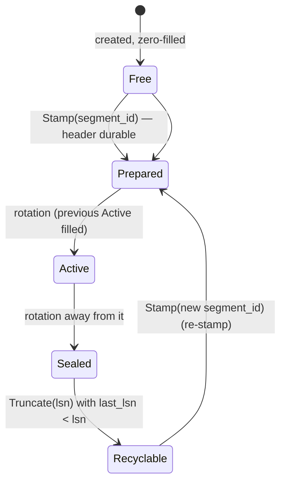
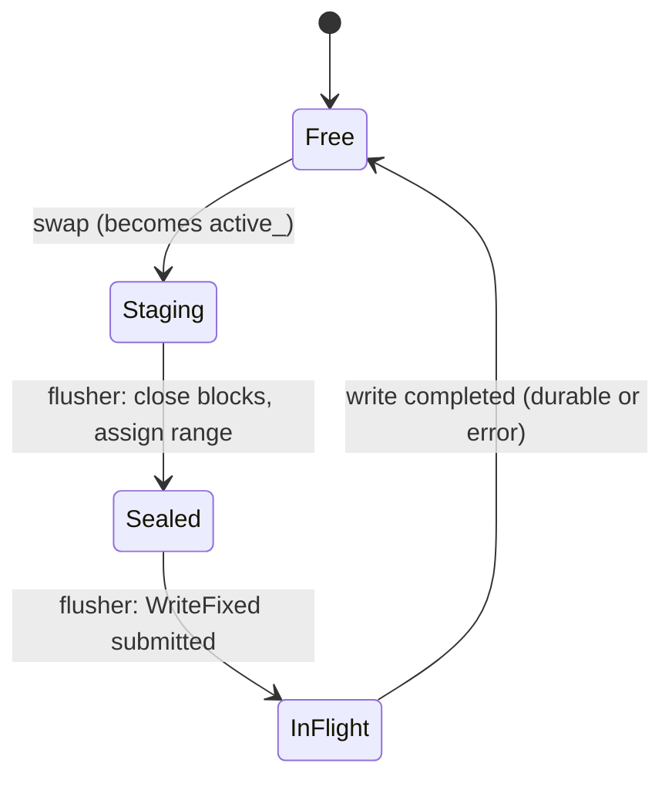

# RFC: tinyio WAL v1 — Format, Writer Concurrency and Recovery Specification

- **Status**: Draft (normative once accepted)
- **Date**: 2026-10-27
- **Target area**: `src/tinyio/wal/`
- **Supersedes**: the framing sketched in `src/tinyio/wal/wal.hpp` (per-record `length|seq|salt|payload|crc`) and the in-place tail rewrite (Strategy 1B) of [`docs/wal-rfc.hpp`](file:///Users/ynachi/codes/tinyio/docs/wal-rfc.hpp). The 4 KiB block/fragment structures of [`src/tinyio/wal/common.hpp`](file:///Users/ynachi/codes/tinyio/src/tinyio/wal/common.hpp) are kept, with the changes listed in §12.
- **Background**: option analysis and rationale live in [`wal-state-of-the-art.md`](wal-state-of-the-art.md); section references like "SOTA §6.4" point there.

Key words **MUST**, **MUST NOT**, **SHOULD**, **MAY** are used in the RFC 2119 sense. Anything not stated here is *unspecified*, not "allowed".

---

## 1. Scope and Decisions

This RFC specifies exactly **one** WAL design, the recommended default of SOTA §10:

| # | Decision | Choice | Why (short) |
| :--- | :--- | :--- | :--- |
| D1 | Layout | Segmented log: fixed pool of preallocated slot files holding logical segments | SOTA §3 P1, §7 |
| D2 | Tail strategy | **1A**: sectors are immutable; the last block of a batch is zero-padded; the next batch starts at the next block | No torn-overwrite of acknowledged data; enables pipelining and ZNS later |
| D3 | Durability primitive | Segment files opened `O_DIRECT \| O_DSYNC`; a write that completes is durable. No separate `fsync` on the data path | One awaited operation per batch; FUA fast path on pure overwrites; needs **no** new `IO` API |
| D4 | Commit coordination | One **dedicated flusher fiber**; **one write in flight**; two data buffers (ping-pong) | SOTA §4.2, §4.4 (pipelining deferred) |
| D5 | API shape | `Append(record) -> Lsn` (never waits for disk) and `Sync(lsn)`; `AppendSync` is sugar | SOTA §4.3 |
| D6 | Record size | A record **never straddles a batch**: `max_record_bytes = blocks_per_batch × 4064`. Larger payloads are chunked by the caller | Removes mid-record flushes entirely (§6.5) |
| D7 | Integrity | Per-fragment CRC32C seeded with the segment's generation tag; immutable block header; strict LSN continuity | SOTA §6 |
| D8 | Generation tag | `generation = segment_id` (a logical id that is never reused), not a separate epoch counter | Known before the slot is used; no extra state |
| D9 | Recycling | Fixed-name slot files; recycle by re-stamping the 4 KiB header; **no rename, no unlink, no allocation** at runtime | SOTA §7 |
| D10 | Recovery | Linear scan of live segments; torn-tail vs corruption classified with a bounded look-ahead; tear window zeroed before appends resume | SOTA §6.4, §6.5 |
| D11 | Errors | Any I/O error on the commit path is **fatal** to the log (latched) | SOTA §1.5 |
| D12 | Sharding | One log per `IO` (core); no cross-log ordering | SOTA §8.1 |

**Non-goals for v1**: pipelined (multi-in-flight) flushes, compression, encryption, checkpoint-hint tail search, binary-search recovery, ZNS / raw device / passthrough substrates, cross-shard ordering, Raft-specific features (suffix truncation, hard state). §14 says where each hooks in.

**Runtime requirements**: none beyond what [`runtime.hpp`](file:///Users/ynachi/codes/tinyio/src/tinyio/runtime/runtime.hpp) already provides — `Open` with `O_DIRECT|O_DSYNC`, `WriteFixed`, `ReadFixed`, `Fallocate`, `Fsync` (for the directory and for pool initialisation), `TakeFixedBuffer`, `Spawn`, `Baton`. The pool's `slot_size` MUST be a multiple of 4096 and ≥ `blocks_per_batch × 4096`.

---

## 2. Terminology and Constants

| Term | Meaning |
| :--- | :--- |
| **block** | 4096 bytes, the unit of every disk write and read. Byte offset on disk = `block_index × 4096` |
| **slot** | One physical file in the pool: `slot_NNNN.wal`. Never renamed or deleted after creation |
| **segment** | A *logical* segment: the content of a slot during one generation. Identified by `segment_id` (u64, strictly increasing, never reused) |
| **batch** | The blocks written by one `WriteFixed`: a whole number of blocks, ≤ `max_batch_blocks`, all inside one segment |
| **LSN** | u64 record sequence number. Dense (`+1` per record), first LSN is `initial_lsn` (default 1). `0` is reserved |
| **durable_lsn** | Highest LSN such that it and every smaller LSN is durable on the device |
| **tail** | Position (`segment`, `block`) where the next batch will be written |

All integers on disk are **little-endian**. All structures are naturally aligned. Checksums use `google/crc32c` (`crc32c::Extend`); there is no byte-swapping on supported targets (x86_64, aarch64 little-endian only).

```cpp
constexpr uint32_t kBlockSize        = 4096;
constexpr uint32_t kBlockHdrSize     = 16;
constexpr uint32_t kRecHdrSize       = 16;
constexpr uint32_t kMaxFragPayload   = kBlockSize - kBlockHdrSize - kRecHdrSize;  // 4064
constexpr uint32_t kMinRecSpace      = kRecHdrSize + 1;                           // 17: smallest fragment
constexpr uint16_t kNoNewRecord      = 0xFFFF;
```

Defaults (all configurable except `kBlockSize`): `segment_blocks = 16384` (64 MiB), `max_batch_blocks = 64` (256 KiB, one `FixedBuffer` slot), `slot_count = 8`.

---

## 3. On-Disk Format

### 3.1 Directory and Slot Files

```
<dir>/
  slot_0000.wal   slot_0001.wal  ...  slot_{K-1}.wal       K = slot_count
```

- Every slot file has the **same fixed size** `segment_blocks × 4096` for the life of the log (a different `segment_blocks` in the options than in an existing header is an `InvalidArgument` error on open, except via an explicit offline migration tool; out of scope).
- A slot file is created once (at log creation, §5.1), zero-filled and `fsync`ed along with its directory; thereafter its *content* changes but its *name, size and extents* do not.
- A slot's file offset 0 holds the **segment header** (block 0); blocks `1 … segment_blocks-1` hold data blocks.

```
 slot file (segment_blocks × 4096 bytes), one generation:
 +--------------------+----------------+----------------+-----+----------------+-----------------+
 | Block 0            | Block 1        | Block 2        | ... | Block t-1      | Block t ...     |
 | SegmentHeader      | data (batch 1) | data (batch 1) |     | data (batch n) | zeros, or STALE |
 | written once,      |                |                |     |                | blocks of an    |
 | durable BEFORE     |                |                |     |                | older generation|
 | any data block     |                |                |     |                | (rejected by §3.5)|
 +--------------------+----------------+----------------+-----+----------------+-----------------+
```

### 3.2 Segment Header (Block 0)

64 meaningful bytes, then zero padding to 4096 bytes.

| Offset | Size | Field | Rule |
| :--- | :--- | :--- | :--- |
| `0x00` | 8 | `magic` | `0x57414C5F32303236` (`"WAL_2026"` as in `common.hpp`) |
| `0x08` | 4 | `format_version` | `2` (version `1` was the unreleased draft format; it is void) |
| `0x0C` | 4 | `shard_id` | Owning `IO::Id()`; informational, checked equal across slots |
| `0x10` | 8 | `segment_id` | ≥ 1; low 32 bits MUST be non-zero (ids whose low 32 bits are 0 are skipped when assigning) |
| `0x18` | 8 | `log_id` | Random 64-bit value chosen at log creation; identical in every slot of one log |
| `0x20` | 4 | `block_size` | MUST be `4096` |
| `0x24` | 4 | `segment_blocks` | Total blocks in the file including block 0 |
| `0x28` | 4 | `max_batch_blocks` | Largest batch (in blocks) the writer may ever write into this segment. Defines the tear window (§7.4) |
| `0x2C` | 4 | `reserved` | MUST be 0 |
| `0x30` | 8 | `reserved2` | MUST be 0 |
| `0x38` | 8 | `header_crc` | `Checksum64` (§3.6) of bytes `[0x00, 0x38)` |
| `0x40` | 4032 | padding | MUST be 0; not covered by the CRC; ignored on read |

A header is **valid** iff `magic`, `format_version`, `block_size` match, `segment_id` is non-zero in its low 32 bits, and `header_crc` verifies. Fields that changed relative to `common.hpp`'s `WalSegmentHeader`: `segment_epoch`, `base_lsn`, `prev_segment_max_lsn` are **gone** (D8: generation is `segment_id`; first LSN of a segment is read from its first block — the header is stamped *before* the preceding segment has ended, so it cannot know it); `log_id`, `block_size`, `segment_blocks`, `max_batch_blocks` are new.

The generation tag used in blocks and CRCs is

```
gen32(segment) = static_cast<uint32_t>(segment_id)      // never 0 by construction
```

### 3.3 Data Block

```
 offset 0                16                                                    4096
        +---------------+----------------------------------------------------+
        | BlockHeader   | fragment | fragment | ... | zero padding (≥ 0 B)   |
        | 16 B          | (RecHdr 16 B + payload)                            |
        +---------------+----------------------------------------------------+
```

`BlockHeader` (16 bytes, written exactly once, when the block is *closed* — §6.3):

| Offset | Size | Field | Rule |
| :--- | :--- | :--- | :--- |
| `0x00` | 8 | `block_crc` | `Checksum64` of bytes `[0x08, 0x10)`; MUST be non-zero |
| `0x08` | 4 | `gen32` | `gen32` of the owning segment (non-zero) |
| `0x0C` | 2 | `first_rec_offset` | Byte offset (in `[16, 4080]`) of the **first `FULL` or `FIRST` fragment header in this block**, or `0xFFFF` if there is none |
| `0x0E` | 2 | `reserved` | MUST be 0 |

(The in-flight design of `common.hpp` derived `first_rec_offset` from the block's *first* fragment so that it never changed. Because v1 blocks are immutable, the field is now defined exactly and finalised at close time. It is used by the reader to resynchronise at a record boundary and is cross-checked on every scan.)

A **fragment** is a 16-byte `RecordHeader` followed by `payload_len` bytes:

| Offset | Size | Field | Rule |
| :--- | :--- | :--- | :--- |
| `0x00` | 8 | `lsn` | ≥ 1. All fragments of one record carry the same `lsn` |
| `0x08` | 4 | `record_crc` | CRC32C as defined in §3.6; MUST be non-zero |
| `0x0C` | 2 | `len_and_type` | Low 12 bits `payload_len` (1 … 4064 — **zero-length fragments are invalid**); high 4 bits `RecordType` |
| `0x0E` | 1 | `flags` | Opaque to the WAL; covered by the CRC. Bits are the application's |
| `0x0F` | 1 | `user_meta` | Opaque to the WAL; covered by the CRC |

`RecordType`: `0` `PADDING` (never appears as a type; zero bytes), `1` `FULL`, `2` `FIRST`, `3` `MIDDLE`, `4` `LAST`; `5…15` reserved (a block containing one is invalid).

**Padding.** Within a block, after the last fragment, every byte up to offset 4095 MUST be zero. If fewer than `kMinRecSpace` (17) bytes remain after a fragment, those bytes are padding and no fragment may start there.

### 3.4 Record → Fragment Mapping

A record is `(lsn, flags, user_meta, payload[n])`, `1 ≤ n ≤ max_record_bytes`.

- If it fits in the space left in the current block (`4096 − cur_off − 16 ≥ n`): one `FULL` fragment.
- Otherwise: a `FIRST` fragment that fills the current block to offset 4096 (if the current block has fewer than 17 bytes left, it is closed first and `FIRST` starts in the next block), then zero or more `MIDDLE` fragments of exactly 4064 bytes — each alone in its block, starting at offset 16 — then one `LAST` fragment in the following block, starting at offset 16.
- `MIDDLE`/`LAST` fragments always start at offset 16 of a block; consequently *a block holds at most one continuation fragment, and it is the first fragment of that block*. A block therefore looks like one of:

```
  [FULL|FIRST ...]                       (first_rec_offset = 16)
  [LAST][FULL|FIRST ...]                 (first_rec_offset = 32 + len(LAST), or 0xFFFF if LAST left < 17 B / nothing follows)
  [MIDDLE]                               (first_rec_offset = 0xFFFF, block full)
```

Worked example (block = 4096 B; record A = 10 000 B at LSN 99 starting at offset 16 of block b; record B = 500 B at LSN 100):

```
 block b    : hdr(first_rec_offset=16)   | FIRST  lsn=99  len=4064  | (block full, offset 4096)
 block b+1  : hdr(first_rec_offset=0xFFFF)| MIDDLE lsn=99  len=4064  | (block full)
 block b+2  : hdr(first_rec_offset=1896) | LAST   lsn=99  len=1872  | FULL lsn=100 len=500 | zero padding
                                           ^16..4080-?     16+16+1872=1904 ... see note
```
(`32 + 1872 = 1904`: the first byte after `LAST`, where the `FULL lsn=100` header starts, so `first_rec_offset` is `1904`. A 10 000-byte record is `4064 + 4064 + 1872` bytes of payload.)

### 3.5 Block and Segment Validity (normative for readers and recovery)

A **data block** `b` of segment `S` is *valid* iff **all** of:

1. `block_crc` verifies and `gen32` equals `gen32(S)`. (A zero block, or a block left over from an older generation of the slot, fails here.)
2. `reserved == 0`.
3. Scanning fragments from offset 16: each fragment header lies within the block with ≥ 17 bytes remaining; type ∈ {1..4}; `1 ≤ payload_len ≤ min(4064, bytes remaining after the header)`; `record_crc` verifies (§3.6); the scan ends exactly when fewer than 17 bytes remain or the next 16 bytes are all zero.
4. Every byte from the end of the last fragment to offset 4095 is zero.
5. Fragment sequencing: let `expected` be the next LSN (the previous valid block's last completed LSN + 1, or the LSN continuity anchor of §7.2). Then `FULL`/`FIRST` fragments have `lsn == expected` (and `expected` increments after `FULL` or `LAST`); a `MIDDLE`/`LAST` fragment has the same `lsn` as the pending `FIRST`, appears only as the first fragment of block `b`, and block `b−1` ended with that pending record.
6. `first_rec_offset` equals the actual offset of the first `FULL`/`FIRST` header in the block (or `0xFFFF` if none).

**All-or-nothing:** a block failing any rule is *invalid in its entirety*, even if some of its leading fragments would pass. (This makes the recovered set a deterministic function of the on-disk bytes; the discarded fragments were never acknowledged — see §6.4.)

### 3.6 Checksums

```cpp
// 64-bit, used for SegmentHeader and BlockHeader. As in common.hpp (ComputeWalChecksum64).
uint64_t Checksum64(const void* p, size_t n);   // never returns 0

// per fragment. seed = gen32 of the owning segment.
uint32_t RecordCrc(uint32_t gen32, const RecordHeader& h, const void* payload, size_t n) {
  uint32_t c = crc32c::Extend(gen32, bytes(h) + 0x00, 8);      // lsn
  c          = crc32c::Extend(c,     bytes(h) + 0x0C, 4);      // len_and_type, flags, user_meta
  c          = crc32c::Extend(c,     payload, n);
  return c == 0 ? 1 : c;                                       // 0 is reserved for padding
}
```

`record_crc` itself (`[0x08, 0x0C)`) is skipped. The CRC is computed **once, at staging time**, by the appending fiber (the payload is hot in cache); the flusher computes **no** payload checksums, only the 8-byte `block_crc` at block close.

---

## 4. Configuration

```cpp
struct Options {
  std::filesystem::path directory;
  uint32_t segment_blocks   = 16384;  // 64 MiB; multiple of 1, >= 2 * max_batch_blocks
  uint32_t max_batch_blocks = 64;     // buffer size / 4096; <= pool slot_size / 4096
  uint32_t slot_count       = 8;      // >= 3: active + prepared + >= 1 retained
  uint64_t initial_lsn      = 1;      // used only when creating a log
  Durability durability     = Durability::DSync;   // see 4.1
  uint32_t lookahead_blocks = 256;    // recovery corruption look-ahead (7.3)
  uint64_t max_unflushed_age_us = 0;  // 0 = never flush unless Sync/space demands it (6.7)
  mode_t file_mode = 0644, dir_mode = 0755;
};
```

### 4.1 Durability Modes

| Mode | Open flags | Data-path durability | Notes |
| :--- | :--- | :--- | :--- |
| `DSync` (default) | `O_RDWR \| O_DIRECT \| O_DSYNC` | Completion of `WriteFixed` ⇒ durable | Requires pure overwrites for the FUA fast path (guaranteed by §5 zero-fill) |
| `Fdatasync` | `O_RDWR \| O_DIRECT` | `WriteFixed` then `Fsync(fd, datasync=true)` | For filesystems where `O_DSYNC` is slow; one extra await per batch |
| `Unsafe` | no `O_DIRECT`, no sync | None | Tests on tmpfs only; the format is identical; the writer logs an error at startup |

`O_DSYNC` on the *file description* applies to every write through that fd, including the segment header write and the tear-window zeroing — so they are durable on completion too, which is exactly what §5 and §7.4 rely on.

---

## 5. Pool and Segment Lifecycle

### 5.1 Creating a Log (empty directory)

1. `mkdir -p`; choose `log_id` randomly (`getrandom`).
2. For `i` in `0..K-1`: `open(slot_i, O_CREAT|O_EXCL|O_RDWR|O_DIRECT[|O_DSYNC])`, `Fallocate(fd, 0, 0, segment_blocks×4096)`, then **write zeros over the whole file** in `max_batch_blocks`-sized chunks from the control buffer (§6.1), then `Fsync(fd)` (needed even in `DSync` mode: the file *length/extents* must be durable).
3. `Fsync(dirfd)`.
4. Stamp slot 0 with `segment_id = 1` and slot 1 with `segment_id = 2` (§5.3). Slot 0 becomes the **Active** segment (tail = block 1, `next_lsn = initial_lsn`); slot 1 is **Prepared**.
5. Slots 2.. are **Free**.

A directory that contains *some but not all* of the `K` slot files, or slot files of differing sizes, is a creation that crashed. It is **not** a recoverable log: `Open` fails with `InvalidArgument` unless the directory contains **no** valid segment header at all, in which case it MAY be wiped and re-created (operator decision; flag `allow_reinit`).

### 5.2 Slot / Segment State Machine



| State | On disk | In memory (`SlotInfo`) |
| :--- | :--- | :--- |
| **Free** | No valid header (zeros, or torn header) | `segment_id = 0` |
| **Prepared** | Valid header, no valid data blocks | `segment_id`, fd open |
| **Active** | Valid header + data blocks up to the tail | `first_lsn`, tail block |
| **Sealed** | Valid header + data; never written again | `first_lsn`, `last_lsn` |
| **Recyclable** | As Sealed, but every record `< truncate_lsn` | same |

At all times, at most **one** slot is Active and at most **one** is Prepared.

### 5.3 Stamping a Slot (create or recycle)

`Stamp(slot, segment_id)` is the *only* operation that writes block 0:

1. Build the 4096-byte header in the **control buffer** (§6.1) with `segment_id`, `log_id`, etc.
2. `WriteFixed(slot.fd, ctrl, 4096, offset 0)` — durable on completion (`DSync`), or followed by `Fsync` (`Fdatasync`).
3. Only after step 2 returns success is the slot **Prepared** and may data blocks be written to it. *(Invariant W8.)*

Recycling does **not** clear the old data blocks. They carry the previous generation's `gen32` and are rejected by rule 3.5-1. This is why `segment_id` must never repeat (D8).

**Crash windows of `Stamp`** (every one must recover, §9):

| Crash point | Disk state of block 0 | Recovery result |
| :--- | :--- | :--- |
| Before the write is issued | Old header (valid, an obsolete generation) or zeros | Slot looks like its old segment (obsolete, below any checkpoint) or Free |
| During the write (torn 4 KiB) | Bad `header_crc` | Slot is Free (its old content was already obsolete) |
| After the write | New header | Slot is Prepared; stale body blocks rejected |

All three are safe **only because** `Truncate` (§6.8) is called with an LSN the application has already made durable elsewhere — see the contract there.

### 5.4 Rotation

The flusher decides rotation **when it seals a batch** (§6.3), not when it fills a buffer:

```
new_start = batch.start_block + batch.nblocks          // first block of the NEXT batch
if (segment_blocks - new_start < max_batch_blocks_of(segment))   // cannot guarantee a full batch fits
    next batch → Prepared segment, start_block = 1 (rotation)
else
    next batch → same segment, start_block = new_start
```

The unused tail of the old segment (`< max_batch_blocks` blocks, ≤ 0.4 % of a 64 MiB segment) is abandoned: it stays zeros or stale, and the reader treats "valid data ended here" as the segment end (§7).

Because the next batch's destination segment (hence its `gen32`, which seeds its CRCs) is fixed when the *previous* batch is sealed — i.e. **before the next batch has staged a single byte** — staging never needs to know about rotation. *(Invariant W9.)*

Rotation completes (switch active slot, spawn the preparer for the next segment, mark the old one Sealed) when the batch that started the new segment is submitted. If the Prepared slot is not ready at that point (preparer slow, or pool exhausted because nothing was `Truncate`d), the flusher **parks** until it is; this is back-pressure, surfaced through metrics (§11).

### 5.5 Preparer

A single fiber, spawned at `Start()` and re-armed after every rotation, whose job is to keep one segment Prepared:

```
Preparer:
  loop:
    wait until prepared_slot == none      (re-checked after each rotation)
    slot = a Free or Recyclable slot with no pinned readers    // ordered by lowest segment_id
    if none: park on pool_free baton; continue                // Truncate() posts it
    id = next_segment_id++ ; (skip ids with low 32 bits == 0)
    Stamp(slot, id)                                           // §5.3, uses ctrl buffer
    on error: latch fatal error (D11)
    prepared_slot = slot ; post flusher_waiting_for_prepared if parked
```

The preparer and the flusher both write only through `FixedBuffer`s they own (`ctrl` vs `buf[0..1]`); neither touches the other's buffer, and the preparer never writes to the Active slot.

---

## 6. The Writer

### 6.1 Resources

Per `Writer` (one per `IO`), leased from the `IO`'s fixed-buffer pool at `Start()` and released in `Shutdown()`:

| Resource | Count | Use |
| :--- | :--- | :--- |
| Data `FixedBuffer` `buf[0]`, `buf[1]` | 2 | ping-pong staging / DMA source, each `max_batch_blocks × 4096` |
| Control `FixedBuffer` `ctrl` | 1 | header stamping, zero-fill, tear-window zeroing, recovery reads |
| Fibers | 2 | flusher, preparer (both spawned in `Start()`) |

### 6.2 State

All state is owned by the single `IO` thread; **no atomics or locks**. Exclusion between fibers is by *not suspending* in critical sections (cooperative scheduling, SOTA §4).

```cpp
// --- identity / config ---
IO& io_;  Options opt_;  uint64_t log_id_;
// --- error & lifecycle ---
int      err_ = 0;                       // latched errno; 0 = healthy
enum class Phase { Running, Draining, Closed } phase_ = Running;
// --- LSN watermarks ---
uint64_t next_lsn_;                      // next LSN to assign
uint64_t staged_lsn_;                    // highest LSN fully staged (next_lsn_-1)
uint64_t durable_lsn_;                   // highest durable LSN
// --- double buffering ---
struct Batch {
    enum class State { Free, Staging, Sealed, InFlight } state;
    uint8_t*  data;                      // buffer base
    uint32_t  seg_slot;                  // destination slot
    uint32_t  gen32;                     // seeds the record CRCs of this batch
    uint32_t  start_block;               // destination block in that slot
    uint32_t  nblocks;                   // valid once Sealed
    uint64_t  first_lsn, last_lsn;       // LSN range of complete records (valid once Sealed)
    SyncWaiter* waiters_head, *waiters_tail;   // FIFO of fibers waiting for this batch's durability
} batch_[2];
uint8_t  active_ = 0;                    // index of the Staging batch
// --- staging cursor (within batch_[active_]) ---
uint32_t cur_blk_;                       // block index within the buffer, 0 .. max_batch_blocks-1
uint32_t cur_off_;                       // byte offset within that block, 16 .. 4096
uint16_t cur_first_rec_off_;             // first_rec_offset for the open block (0xFFFF until set)
// --- requests to the flusher ---
bool     flush_wanted_ = false;          // a Sync waiter, a space waiter, Flush(), or age timer
Baton*   flusher_wake_ = nullptr;        // published sleeping baton of the flusher (null while awake)
// --- admission ---
SpaceWaiter* space_head_, *space_tail_;  // FIFO of Append() callers waiting for room
// --- pool ---
std::vector<SlotInfo> slots_;  int active_slot_, prepared_slot_;
Baton* preparer_wake_ = nullptr; Baton* flusher_prep_wait_ = nullptr;
```

`SyncWaiter` and `SpaceWaiter` are **stack-allocated** intrusive nodes `{ Baton done; Node* next; }` (as in `wal-rfc.hpp`). A fiber MUST NOT leave `Sync`/`Append` while its node is linked. Since `Baton::Wait()` has no cancellation path (a parked waiter is released only by `Post()`), the only ways out are `durable_lsn_` advancing, the error latch, or `Shutdown()` — each of which posts every waiter (W7, W11).

### 6.3 Buffer / Batch State Machine



Invariants of the machine: **at most one** batch is `Staging` (it is `batch_[active_]`); **at most one** is `Sealed` or `InFlight` (and the flusher is the only fiber that moves a batch out of `Staging`); `Sealed` is held only for the duration of one non-suspending swap, then immediately `InFlight` after the flusher issues the write.

**Block close** (`CloseBlock(blk)`): zero bytes `[cur_off_, 4096)` of the block; write the 16-byte header (`gen32`, `first_rec_off`, `reserved=0`, `block_crc`). Called by the stager when the block cannot hold another fragment (`4096 − cur_off_ < 17`) and by the flusher for the final block at seal.

**Swap / Seal** (executed by the flusher with no suspension point inside):

```
SealAndSwap():
  b = active_
  nblocks = cur_blk_ + (cur_off_ > 16 ? 1 : 0)           // blocks that contain data
  CloseBlock(last block if cur_off_ > 16)
  batch_[b].nblocks = nblocks
  batch_[b].first_lsn/last_lsn = range of complete records in it
  batch_[b].state = Sealed
  // choose the destination of the NEXT batch (§5.4)
  (seg, start) = next_destination(batch_[b])
  other = 1 - b                                           // is Free by W1
  batch_[other] = { Staging, seg, gen32(seg), start, ... }
  active_ = other; cur_blk_ = 0; cur_off_ = 16; cur_first_rec_off_ = 0xFFFF
  wake head of space FIFO (it may now fit)
  return b
```

### 6.4 `Append` — Staging a Record

```
Result<Lsn> Append(span payload, uint8_t flags = 0, uint8_t user_meta = 0):
  if (err_)                         return Error(err_)
  if (phase_ != Running)            return Error(ESHUTDOWN)
  n = payload.size()
  if (n == 0 || n > MaxRecordBytes) return Error(EINVAL)       // MaxRecordBytes = max_batch_blocks * 4064

  // ---- admission (may suspend) ----
  if (space_fifo_nonempty() || !Fits(n)):
      SpaceWaiter w(io_); enqueue(w)            // FIFO, even if Fits(n) now, to keep fairness
      while (true):
          flush_wanted_ = true; WakeFlusher()   // a full/overflowing buffer demands a flush
          w.done.Wait()                          // woken by SealAndSwap or by error/shutdown
          if (err_) return Error(err_)           // (node already dequeued by the waker)
          if (phase_ != Running) return Error(ESHUTDOWN)
          if (Fits(n)) break
          re-enqueue w at the HEAD, with a fresh Baton   // lost the race; stays first
      dequeue w

  // ---- staging: NO suspension from here to the return (W5) ----
  lsn = next_lsn_++
  StageFragments(lsn, payload, flags, user_meta)      // §3.4; computes RecordCrc per fragment
  staged_lsn_ = lsn
  batch_[active_].last_lsn = lsn; if (first_lsn unset) first_lsn = lsn
  wake next space waiter (if it fits)                 // chain wake keeps FIFO
  return lsn
```

`Fits(n)` is evaluated against the *active* batch:

```
Stageable(cur_blk_, cur_off_) =
    (4096 - cur_off_ >= 17 ? (4096 - cur_off_ - 16) + (B - cur_blk_ - 1) * 4064
                            :                          (B - cur_blk_ - 1) * 4064)
Fits(n) = n <= Stageable(cur_blk_, cur_off_)          // B = max_batch_blocks
```

When `Fits` is false the record does not straddle: the flusher seals the active batch *now* (padding its tail) and the record is staged at block 0 of the fresh buffer. By D6 `n ≤ B·4064`, so it **always fits in an empty buffer** — admission cannot loop forever. The price is at most one record of padding per batch.

**Why `Append` returns before disk:** it never touches `io_uring`. A caller that needs durability calls `Sync(lsn)`.

### 6.5 Why Records Never Straddle Batches

`wal-rfc.hpp` allowed records larger than the buffer, which forced Invariant 3 (the flusher writing a buffer ending in an unfinished `FIRST` fragment, with the owning fiber parked in the space queue and *not yet* a sync waiter), plus a `staged_complete_lsn_` watermark and a "no `FULL` may interleave between `FIRST` and `LAST`" admission rule. Bounding the record size removes all three: every batch contains only whole records, `durable_lsn_ = batch.last_lsn` is always exact, and a torn batch can never leave a record half-acknowledged. Payloads larger than 253 KiB (B=64) are the caller's to chunk (a Raft entry is typically ≪ 1 MiB; bulk values use a separate store).

### 6.6 `Sync` and `AppendSync`

```
Result<void> Sync(Lsn lsn):
  if (lsn <= durable_lsn_)  return OK                       // fast path, never suspends
  if (err_)                 return Error(err_)
  CHECK(lsn <= staged_lsn_)                                  // syncing an LSN never appended is a bug
  SyncWaiter w(io_)
  b = (lsn <= batch_[1-active_].last_lsn && batch_[1-active_].state is InFlight/Sealed) ? 1-active_ : active_
  link(batch_[b].waiters, &w)                                // FIFO
  flush_wanted_ = true; WakeFlusher()
  w.done.Wait()                                              // posted by the flusher after durable_lsn_ advanced, or by error/shutdown
  return err_ ? Error(err_) : OK                             // err_ re-read AFTER waking (W6/W7)

Result<Lsn> AppendSync(...) { lsn = TRY(Append(...)); TRY_VOID(Sync(lsn)); return lsn; }
```

`Sync(lsn)` for an LSN ≤ `durable_lsn_` from a *previous run* (recovered) returns immediately.

### 6.7 The Flusher Fiber

```
FlusherLoop():
  loop:
    // 1. sleep until there is something to do (the Baton re-check rule: SOTA §4.2 / fiber_sync.hpp)
    while (!(WantFlush() || (phase_ == Draining && Drained()))):
        Baton wake(io_); flusher_wake_ = &wake; wake.Wait()      // no lost wakeup: predicate re-checked
    if (phase_ == Draining && Drained()) break

    if (err_):  FailAll();  continue                              // W7: never submit again

    // 2. seal the active batch, choose next destination, swap buffers
    b = SealAndSwap()
    ensure the destination slot of batch_[b] is Prepared and is Active:   // rotation, §5.4
        if batch_[b].seg_slot != active_slot_:
            while (prepared_slot_ not ready): park on flusher_prep_wait_      // back-pressure
            if (err_) { FailAll(); continue; }
            active_slot_ = prepared_slot_; prepared_slot_ = none; mark old Sealed; WakePreparer()

    // 3. write (the ONLY suspension of the flusher); durable on completion in DSync mode
    batch_[b].state = InFlight
    r = io_.WriteFixed(slot[batch_[b].seg_slot].fd, buf[b], nblocks*4096, start_block*4096)
    if (r is error or *r != nblocks*4096)   { Latch(errno or EIO); FailAll(); continue; }
    if (opt_.durability == Fdatasync) { rc = io_.Fsync(fd, true); if (!rc) { Latch(...); FailAll(); continue; } }

    // 4. publish — NO suspension between these statements
    durable_lsn_ = batch_[b].last_lsn
    slot.last_lsn = ...; slot.tail_block = start_block + nblocks
    post every waiter in batch_[b].waiters (FIFO order); clear list
    batch_[b].state = Free
    wake head of space FIFO                                       // buffer b is free again
    // loop: if data staged meanwhile, WantFlush() is already true -> next batch starts immediately

WantFlush() := batch_[active_] has data && (flush_wanted_ || (opt_.max_unflushed_age_us && age >= ...))
Drained()   := batch_[active_] empty && no InFlight batch
```

`flush_wanted_` is cleared by `SealAndSwap` (the new active batch starts with no demand). A `Sync` or full buffer arriving *during* the in-flight write sets it again, so the next iteration flushes at once — this is the group-commit behaviour: **batch size = whatever was staged during the previous write**.

**Wakeups are never lost** because every producer first changes the predicate state (`flush_wanted_`, staged data, phase) and only then calls `WakeFlusher()` (`if (flusher_wake_) std::exchange(flusher_wake_, nullptr)->Post()`), and the flusher re-checks the predicate after publishing its baton with no suspension in between (the contract in `fiber_sync.hpp`).

**Latch / FailAll**:

```
Latch(e):   if (!err_) { err_ = e; log FATAL-class ERROR }
FailAll():  post every waiter of both batches (their Wait() returns; they re-read err_)
            wake all space waiters; wake preparer so it can exit; durable_lsn_ is NOT advanced
```

After the latch the flusher keeps running only to drain wakeups until `Shutdown()`.

### 6.8 `Truncate` (Retention) and Reader Pins

```
void Truncate(Lsn lsn):          // "records < lsn are no longer needed"
  for each Sealed slot s with s.last_lsn < lsn and s.pins == 0: s.state = Recyclable
  if any slot became Recyclable: wake preparer (pool_free)
```

**Contract.** The caller MUST have made its *replacement for the dropped records* durable (checkpoint/snapshot written and synced) **before** calling `Truncate`. The WAL persists nothing about truncation: after a crash, recovery sees whatever segments still carry valid headers, and the application's own checkpoint says where to start replaying (§7.6). `Truncate` is monotonic; a smaller `lsn` than a previous call is ignored. `Active` and `Prepared` slots are never recycled. A `Reader` (§8) *pins* the slots it is scanning (`pins++`); a pinned slot is not recycled.

### 6.9 `Start`, `Shutdown`, Destruction

```
Start(RecoveredLog | fresh):  lease buf[0], buf[1], ctrl; adopt slots/tail/next_lsn from recovery (§7.5);
                              if the tail's segment max_batch_blocks < opt.max_batch_blocks or has < B blocks left: treat as full (rotate at first seal);
                              spawn flusher; spawn preparer; phase_ = Running

Shutdown():   phase_ = Draining (new Append -> ESHUTDOWN; Sync of already-staged LSNs still allowed)
              WakeFlusher(); wait on exit baton until flusher exits (it flushes the remaining staged data first unless err_)
              post all remaining waiters; wake & join preparer
              release buf/ctrl leases; close fds via io_; phase_ = Closed

~Writer():    if phase_ != Closed or any waiter linked or any fiber still running: FATAL + abort (as wal-rfc.hpp does)
```

`AbortIfParkedFibers()` (see `AGENTS.md`) must never fire because of the WAL: every parked WAL fiber is released by `Shutdown()` (flusher, preparer: explicit exit batons; Sync/Append waiters: `FailAll`/final flush).

### 6.10 Invariants (normative; each is a test target, §10)

| ID | Invariant |
| :--- | :--- |
| **W1** | At most one `WriteFixed` for **data** is outstanding per `Writer`. |
| **W2** | `durable_lsn_` advances only to `batch.last_lsn` of a batch whose write returned success, batches complete in the order they were sealed, so every `lsn ≤ durable_lsn_` is durable. |
| **W3** | Every record lies entirely within one batch, hence entirely within one segment. |
| **W4** | LSNs are assigned in staging order; staging order is batch order; batch order is disk order (block index increases, segment id increases). |
| **W5** | Between `lsn = next_lsn_++` and the end of `StageFragments`, the fiber does not suspend. |
| **W6** | `Sync(l)` returns OK only after the flusher set `durable_lsn_ ≥ l` and `err_ == 0` at wake time. |
| **W7** | Once `err_ != 0`: no data write is issued; `durable_lsn_` is frozen; every current and future `Append`/`Sync` returns the error; every parked waiter is posted. |
| **W8** | No data block is written to a slot before that slot's header write completed successfully. |
| **W9** | A batch's destination (`seg_slot`, `gen32`, `start_block`) is fixed when the previous batch is sealed, before any record is staged into it. |
| **W10** | Only the flusher writes data blocks; only the preparer writes block 0 of non-Active slots; the Active slot's block 0 is never rewritten. |
| **W11** | After `Shutdown()` returns: no WAL fiber exists, no waiter is linked, no `FixedBuffer` is leased. |
| **W12** | A block, once its write completes, is never written again until its slot is re-stamped (immutable sectors, D2). |

### 6.11 Timeline Example (3 fibers, one flusher)

```
 t0   F1 Append(r1)→lsn1   F1 Sync(1): link on batch0.waiters, flush_wanted_, wake flusher
 t1   F2 Append(r2)→lsn2   F3 Append(r3)→lsn3   (flusher not yet run: same tick, still batch0)
 t2   flusher: SealAndSwap -> batch0 = {lsn1..3, nblocks=1}, active_ = batch1
      WriteFixed(batch0) submitted           (flusher suspended in io_uring)
 t3   F2 Sync(2): lsn2 ≤ batch0.last_lsn and batch0 InFlight → link on batch0.waiters
      F4 Append(r4)→lsn4 (stages into batch1)   F4 Sync(4): link on batch1.waiters, flush_wanted_
 t4   CQE: write done.  durable_lsn_ = 3.  post F1, F2  (F3 never called Sync)
      flusher loop: WantFlush() is true (batch1 has data + demand) → SealAndSwap(batch1) → WriteFixed
 t5   CQE: durable_lsn_ = 4. post F4.
```

One write is in flight at any time; the record staged *during* a write waits at most one write latency to start its own, and batch size self-adjusts to arrival rate × write latency.

---

## 7. Recovery

### 7.1 Inputs and Outputs

```cpp
struct RecoveredLog {
  uint64_t log_id; uint32_t segment_blocks, max_batch_blocks_of_tail;
  std::vector<SlotInfo> slots;          // state, segment_id, first_lsn, last_lsn per slot
  int      active_slot;  uint32_t tail_block;       // where appends resume (before tear-window zeroing)
  uint64_t last_lsn;     uint64_t next_lsn;          // next_lsn = last_lsn + 1, or initial_lsn if empty
  Stats    stats;        // bytes scanned, blocks discarded, torn-tail bytes, duration
};
Result<RecoveredLog> Recover(IO&, const Options&, Lsn from_lsn, ReplayFn on_record /* may be null */);
```

`Recover` leases a single `FixedBuffer` (`ctrl`-sized) for reads and spawns **no** fibers. `Writer::Start` consumes the result — the log is scanned **once**.

### 7.2 Algorithm

```
Recover(from_lsn):
 1. DISCOVER. List <dir>/slot_*.wal. For each: read block 0.
      - header valid and (log_id, shard_id, block_size, segment_blocks) consistent with the first valid header
        → slot has segment_id; else if inconsistent log_id → ERROR(InvalidArgument: foreign slot)
      - header invalid → slot is Free (torn stamp or never stamped)
    If no slot has a valid header: if the directory has no slot files → fresh log (§5.1); else ERROR.
 2. ORDER. Sort slots by segment_id. Two slots with the same segment_id → ERROR(Corruption).
    Let ids = [lo .. hi] of valid slots. Missing id between lo and hi → ERROR(Corruption: gap).
    (A Free slot below `lo` is a torn/obsolete recycle and is fine.)
 3. SCAN each live segment in id order, starting at the first segment that can contain from_lsn
    (the one with the largest first_lsn ≤ from_lsn; first_lsn comes from scanning its block 1, or
     scan from `lo` if from_lsn is 0/unknown). For each segment S:
      expected_lsn:  for the first scanned segment, the LSN of its first record (anything ≥ 1);
                     for later segments, last_lsn(previous) + 1  (continuity across the segment boundary).
      Read blocks 1.. in chunks of max_batch_blocks (ReadFixed), validate each block with §3.5.
      On a valid block: emit complete records (reassembling FIRST/MIDDLE/LAST) with lsn ≥ from_lsn to on_record,
         update last_lsn.
      Stop scanning S at the first INVALID block `t`, or at block segment_blocks.
      Record: S.first_lsn, S.last_lsn, S.end_block = t, any dangling FIRST at end of the last valid block is DISCARDED
         (cannot happen under D6, but a corrupt/foreign file could present one).
      If the next segment S+1 has a valid first block: its first LSN MUST equal last_lsn(S)+1, else ERROR(Corruption: continuity).
         (S ends by rotation, `t` is simply "data ended"; any lost batch inside S shows as a continuity gap.)
 4. CLASSIFY the end of the LAST live segment (§7.3). Torn tail → continue. Corruption → ERROR / repair.
 5. TAIL. Active = last live segment. next_block = end_block (first invalid block, or segment_blocks).
    Everything valid is kept; blocks ≥ next_block will be (re)written.
 6. HANDOFF. Return RecoveredLog; the Writer will zero the tear window (§7.4) before accepting the first Append.
```

Records delivered to `on_record` are delivered **exactly once, in LSN order**, before `Recover` returns; the callback runs in the calling fiber and may suspend.

### 7.3 Torn Tail vs. Corruption (the classification)

Let `t` be the first invalid block of the last live segment and `B = max_batch_blocks` from that segment's header. A crash can only damage blocks of the **single in-flight batch** (W1), which began at some `s ≤ t` and spans at most `B` blocks, so *any* block that persisted out of order from that batch lies in `[t, t+B)`.

```
 valid blocks ... valid | t (invalid) | t+1 .. t+B-1 (may hold phantom valid-looking blocks) | t+B ... end
                                       ^---- allowed: possible out-of-order persistence ----^   ^-- MUST be empty --^
```

- Examine blocks `t+B … min(t+B+lookahead_blocks, segment_blocks)−1`. A block is **valid-looking** if its `block_crc` verifies and `gen32` matches. If **any** valid-looking block exists there → **Corruption** (acknowledged data may be lost): `Recover` returns `ErrorCode::Corruption` with `{segment_id, block t, first valid-looking block}`; it does **not** truncate. (Replicated deployments repair from a peer — SOTA §6.4 — and re-run recovery.)
- Otherwise → **torn tail**: the discarded blocks held only unacknowledged data. Truncate logically (no write yet), continue.
- `lookahead_blocks = 256` (1 MiB) catches localised damage cheaply. Setting it to `UINT32_MAX` verifies the whole rest of the segment (up to 64 MiB of reads) — recommended after an unclean shutdown on a single-node deployment.

**Known limitation (documented, not solved in v1):** corruption of an *acknowledged* block in the very last batch, with no later data anywhere, is indistinguishable from a torn tail on a single device. Only replication or an external durable-watermark hint can detect it (SOTA §6.4, §14).

### 7.4 Tear-Window Zeroing (before appends resume)

Before the first `Append` is admitted, `Writer::Start` writes **zeros over blocks `[next_block, min(next_block + B, segment_blocks))`** of the Active slot (from the `ctrl` buffer, one write; durable on completion in `DSync`, else followed by `Fsync`), where `B` is the tail segment's `max_batch_blocks`.

Why: the torn batch left possible phantoms in `[t, t+B)`. Appending would reuse LSNs `last_lsn+1…` for new records; a phantom with a matching `gen32` and an *accidentally continuous* LSN, lying beyond where the new, shorter batch ends, would pass §3.5 after a **second** crash and resurrect an unacknowledged record next to different, acknowledged ones. Zeroing makes the next crash start from a clean window. It is idempotent: a crash during zeroing leaves a subset of phantoms in the same window and recovery repeats the procedure.

If `segment_blocks − next_block < B`, the segment is treated as full and appends start in the next Prepared segment; its window (always clean: freshly stamped slots only contain zeros or *old-generation* blocks) needs no zeroing.

### 7.5 Segment Selection for Resuming

- `tail_block ≤ segment_blocks − B` **and** the tail segment's `max_batch_blocks ≥ opt.max_batch_blocks` → resume in the tail segment at `next_block` (after zeroing).
- Otherwise → rotate: the writer starts with the Prepared slot (if recovery found a stamped, empty successor, it is used; else the preparer stamps one first).

### 7.6 Replay Contract with the Application

- The application persists its own checkpoint LSN `C` (everything `< C` is reflected in its durable state).
- On restart it calls `Recover(from_lsn = C, on_record)`. Records with `lsn < C` may be skipped without being delivered; the WAL MAY deliver a few earlier records (segment granularity) — **`on_record` MUST be idempotent with respect to `lsn`** (SOTA §6.6): apply only if `lsn > applied_lsn`.
- It then calls `Truncate(C)` (after its checkpoint is durable) to let segments be recycled.
- A log whose lowest surviving segment starts at `first_lsn > C` has lost records the application still needs → `Recover` returns `ErrorCode::DataLoss` (`from_lsn` below the retained range).

---

## 8. Reader (Replay and Tailing)

```cpp
class Reader {                                   // leases 1 FixedBuffer; spawns no fiber
 public:
  static Result<Reader> Open(IO&, const Options&, Lsn from_lsn);   // pins slots from the one holding from_lsn
  Result<std::optional<RecordView>> Next();      // nullopt at end of *readable* data
  Lsn  NextLsn() const;
  void Close();                                  // unpins
};
struct RecordView { Lsn lsn; uint8_t flags, user_meta; std::span<const std::byte> payload; };  // valid until the next Next()
```

- `Open` uses the writer's in-memory slot table (running process) or `Recover`'s output (cold).
- **Tailing a live log**: a reader MAY read only blocks `< durable_block` where `durable_block` is the writer's `(active_slot, tail_block)` after the last completed batch. Because a block is **immutable once durable (W12)**, a reader can read any block below that cursor with `ReadFixed` while the writer appends, with **no locking and no torn-read risk**. This is the follower catch-up / CDC path (SOTA §8.2) and costs one extra `FixedBuffer` lease per reader.
- Multi-fragment records are reassembled into a reader-owned growable buffer; `payload` points into it.
- A reader that sees an invalid block below the cursor reports `Corruption` (the writer's own memory says it was durable).

---

## 9. Crash-Point Matrix (what must hold after a power cut at each point)

| # | Crash point | On-disk state | Required recovery outcome |
| :--- | :--- | :--- | :--- |
| 1 | After `Append`, before any write | Nothing of the record | Record absent; it was never acknowledged |
| 2 | While batch `n` is in flight | Any subset of its blocks, any order, any block possibly torn at sub-sector granularity | Records of batches `< n` all present. Of batch `n`: a prefix of complete records of valid leading blocks (block-granular all-or-nothing, §3.5) — **never** a record after a gap |
| 3 | Write complete, before waiters posted | Batch durable | Records present (allowed: durable but not yet acknowledged) |
| 4 | After `Sync` returned | Durable | Record present |
| 5 | During rotation, before the new batch is written | Active full, Prepared slot has a header and no data | Tail segment ends; Prepared reused or re-stamped |
| 6 | During `Stamp` (torn 4 KiB header) | Bad `header_crc` | Slot Free; old content was obsolete (§5.3) |
| 7 | Between "header durable" and "first batch written" | Valid header, stale body | Slot Prepared/empty; stale blocks rejected by `gen32` |
| 8 | During tear-window zeroing | Some phantoms may remain in `[t, t+B)` | Same classification on re-run; zeroing repeated |
| 9 | Second crash after recovery + a short batch | Old phantoms zeroed | No resurrection; continuity holds |
| 10 | Bit flip in an acknowledged block with later data | Valid-looking blocks after `t+B` | `Corruption` (never silent truncation) |
| 11 | Bit flip in an acknowledged block, nothing after | Looks like a torn tail | Truncated; **documented limitation** (§7.3) |
| 12 | Crash during pool creation | Some slot files missing/short | `InvalidArgument` unless no valid header (then re-init allowed) |
| 13 | I/O error on a data write (no crash) | Unknown subset persisted | `err_` latched; all waiters get the error; process restarts into case 2 |

---

## 10. Test Plan (each invariant and matrix row maps to tests)

| Layer | Tests |
| :--- | :--- |
| **Format codec** (pure functions, no `IO`) | Round-trip every fragment layout (FULL; FIRST+LAST; FIRST+MIDDLE×k+LAST; LAST+FULL; block exhausted with 1–16 spare bytes); every truncation point of an encoded batch; every single-bit flip (must be rejected); `first_rec_offset` cross-check; all-zero and stale-generation blocks rejected; property test `Decode(Encode(x)) == x` |
| **Writer invariants W1–W12** | Chaos-scheduled fibers (seeded random ready-queue order, from the deterministic-simulator RFC) issuing `Append`/`Sync` with random sizes including `MaxRecordBytes` and `MaxRecordBytes+1`; assert W1 (counter of outstanding writes ≤ 1), W2/W4 (durable prefix, monotone), W5 (assert no yield via a debug flag in `StageFragments`), W7 (fault injection: fail the k-th write, assert no later write and all waiters failed), W11 (shutdown while waiters parked: no `AbortIfParkedFibers`) |
| **Recovery** | Crash at every `WriteFixed` boundary with *k* of *n* blocks persisted in random order and with random sub-sector tearing (simulator `Syscall()` hook): recovered log is a prefix; contains every acknowledged record; **two consecutive crashes** (case 9); phantom block planted at `t+1…t+B−1` accepted; planted at `t+B` ⇒ `Corruption`; torn stamp; stale-generation body |
| **Rotation / recycle** | Tiny segments (e.g. 8 blocks, B=2) so rotation happens every few batches; interleave `Truncate`; verify `Recover` after a crash at every step of `Stamp` and rotation; pool exhaustion back-pressure and release |
| **Reader** | Tailing reader versus live writer under chaos scheduling (never observes a partial block); replay from arbitrary `from_lsn`; `DataLoss` when `from_lsn` < retained |
| **Real device** | `dm-log-writes`/`dm-flakey` power-cut runs (SOTA §9.2); benchmark per the `AGENTS.md` protocol (pre-created file, interleaved arms, same compiler, tinyio-vs-tinyio): `DSync` vs `Fdatasync`; B = 16/64/128 |

---

## 11. Observability (required counters/histograms)

`wal.commit_latency_us{queue,write}` (append→durable split), `wal.batch_blocks`, `wal.batch_records`, `wal.sector_fill_ratio` (payload bytes ÷ `nblocks×4096`), `wal.flushes`, `wal.flush_wait_prepared_us` (rotation stall), `wal.pool_free_slots`, `wal.space_waiters`, `wal.sync_waiters`, `wal.recovery_{duration_us,bytes_scanned,blocks_discarded,corruptions}`, and at startup one log line with `write_cache`, `fua`, filesystem, `max_batch_blocks`, durability mode.

---

## 12. Differences from `docs/wal-rfc.hpp` / `src/tinyio/wal/common.hpp`

| Item | Draft (`wal-rfc.hpp`, `common.hpp`) | v1 (this RFC) | Reason |
| :--- | :--- | :--- | :--- |
| Tail strategy | 1B in-place sub-sector rewrite, carry the partial tail into the next buffer | 1A immutable blocks, zero-pad, next batch starts at next block | No torn overwrite of acknowledged data; allows pipelining; simpler recovery |
| `RecoveredTailState` (4 KiB tail copy) | Zero-read tail handoff | Replaced by `RecoveredLog { slot, next_block }`; no sector copy | Tail block is never rewritten |
| `SwapAndPrepareFlush` carryover `memcpy` | Required | Deleted | 1A |
| Large records | May span buffers (Invariant 3, `staged_complete_lsn_`, admission rule) | Bounded to `B·4064`; never straddle batches | §6.5 |
| Segment header | `epoch`, `base_lsn`, `prev_segment_max_lsn` | `log_id`, `block_size`, `segment_blocks`, `max_batch_blocks`; generation = `segment_id` | Header must be stamped before the previous segment ends |
| `BlockHeader.first_rec_offset` | Derived from the first fragment (immutable) | Exact first `FULL`/`FIRST` offset, finalised at close | Blocks are immutable now |
| Durability | `O_DSYNC` mentioned, `Fsync` in comments | `O_DIRECT\|O_DSYNC` write = durable; `Fdatasync` mode optional | One await, no linking API |
| Recovery | Binary search + tear-window verification | Linear scan of live segments + bounded look-ahead + tear-window zeroing | Binary search cannot see mid-log corruption and needs the "valid prefix" assumption (SOTA §6.5) |
| Recycle | Rename / re-tag | Fixed-name slots, re-stamp header | `rename` is a journalled metadata op |
| Zero flags | `COMPRESSED`, `TX_*`, `CHECKPOINT` constants | `flags`/`user_meta` opaque to the WAL | Not WAL concerns in v1 |
| Zero-length fragment | Allowed (`len ≥ 0`)? | Invalid; `payload_len ≥ 1` | Keeps `0` = padding unambiguous |

`wal.hpp`'s old per-record framing (`length|seq|salt|payload|crc`) and its "TODO" options are removed.

---

## 13. Worked Open / Append / Crash Walk-Through

1. `Open` on an empty directory: create 8 slots of 64 MiB (zero-filled, fsynced), stamp `slot_0000 = segment 1` (Active, tail block 1) and `slot_0001 = segment 2` (Prepared). `next_lsn = 1`.
2. Fibers append 1 KiB records; each `AppendSync`. The flusher writes batch 0 = `[hdr|r1|r2|r3|r4]` (4 records ≈ 4 KiB; the second block is partly used and zero-padded) → blocks `1,2` of segment 1; `durable_lsn = 4`.
3. The next batch starts at block `3`; no tail block is ever rewritten.
4. Power cut during batch 5 (blocks `40…47` in flight): blocks `40,41,42,45` persisted.
5. `Recover`: blocks `1…39` valid; block `40` valid; `41`, `42` valid; block `43` invalid (zeros) → `t = 43`. Block `45` (valid-looking) lies in `[43, 43+64)` → allowed phantom. Look-ahead from `t+B = 107`: nothing → torn tail. `last_lsn` = last complete record in block `42` (dangling `FIRST` dropped if any). `next_block = 43`.
6. `Start` zeroes blocks `43…106`, appends resume at block `43` with `next_lsn = last_lsn+1`.

---

## 14. Extension Points (deliberately not in v1)

| Future feature | Where it plugs in | What v1 already guarantees for it |
| :--- | :--- | :--- |
| **Pipelined flushes** (≥ 3 buffers) | `Batch` array grows; per-batch state machine already exists; durability advances in order | 1A immutable blocks (no two writes to one LBA); `max_batch_blocks` already defines the tear window — it becomes `k × B` |
| **FUA via `RWF_DSYNC`**, **linked write+fsync** | `IO::WriteFixed` gains `rw_flags` / chain API (SOTA §11) | v1 uses `O_DSYNC`, which is equivalent per write |
| **Raft hard state & suffix truncation** | Hard state in a separate twin-slot file; suffix truncation as a logical `TRUNCATE(i)` record type (new `RecordType`, reserved range 5–15) | Reserved record types; `flags/user_meta` opaque |
| **Binary-search / hinted recovery** | `Recover` step 3 | Block-first-LSN is monotonic over the valid prefix; `max_batch_blocks` bounds verification |
| **Compression / AEAD** | Per batch, before framing; nonce = `(segment_id, lsn)` | `gen32` + `lsn` unique per record |
| **Registered files / raw device / ZNS** | `SlotInfo.fd` becomes a registered-file handle / zone id | Strategy 1A is the only mode ZNS supports |
| **Durable watermark hint** (detect case 11) | A small twin-slot "commit hint" updated every *n* ms | Recovery already compares last valid LSN against a hint-shaped value |
| **Cross-shard ordering** | Epoch group commit above `Sync` | Per-shard logs have independent LSN spaces and `shard_id` in every header |

---

## 15. Open Questions

1. **Initial zero-fill cost.** 8 × 64 MiB = 512 MiB written at creation. Acceptable at provisioning; should creation be resumable (zero only slots lacking a valid header) so a crash during creation need not restart from scratch?
2. **`max_unflushed_age_us`.** Default `0` (flush only on demand). Is an always-on small age (e.g. 1 ms) wanted for the `Append`-without-`Sync` users (their data otherwise sits in RAM until a buffer fills)?
3. **Reader pinning vs `Truncate`.** Pins are in-memory only; a reader in another process is not supported (single-process, single-`IO`-thread by design). Confirm that is acceptable for follower catch-up served from the same shard.
4. **Lookahead default.** 1 MiB vs full-segment verification: should a *dirty-shutdown marker* (a clean-close record written by `Shutdown`) select the stricter mode automatically after a crash?
5. **`segment_blocks` change between runs.** Currently rejected; is an online "new segments use the new size" policy wanted (headers already carry their own size)?
